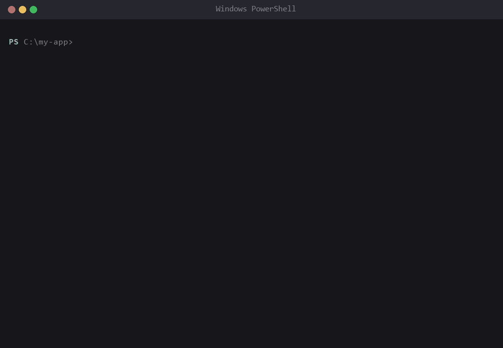

# Bug Zoo

Turn your error messages into collectible monsters.

Run your program through `bugzoo`. When it crashes, the error is caught as a creature and added to a bestiary on your machine. Same error, same monster; rarer errors make rarer creatures.

```
A wild TypeError appeared!  * NEW *
    .-"-.
   / > < \
   \_^_/
   Wobblegnaw  [common]  seen x1
   Cannot read properties of null (reading 'x')
```



*A bug appears, you fix it, it is caught, your team fights. Real output; Node-internal stack frames trimmed.*

[繁體中文說明](README.zh-TW.md)

## Install

```bash
npm install -g bug-zoo
bugzoo setup
```

Requires Node.js 18+. No dependencies.

The first time you run any `bugzoo` command it asks for your **language** (繁體中文 / English), a **player name** for the leaderboards, and whether to turn on **automatic capture**. (npm install scripts cannot prompt, so the questions happen on first run.) Change them any time with `bugzoo setup`.

## Automatic capture (no `bugzoo run`)

With automatic capture on, just run your program as usual:

```bash
node app.js
```

Whatever you run **by hand** in a terminal is captured, in any project, in any folder. Two layers do this:

| Layer | Covers | How |
|---|---|---|
| Node preload | any `node` program started from a terminal | `NODE_OPTIONS` (user environment variable) loads `src/register.js`, which records the run on exit |
| Command wrappers | `python`, `py`, `pytest`, `go`, `cargo`, `java`, `mvn`, `gradle`, `dotnet`, `ruby`, `php`, `deno`, `bun`, `make`, `npm`, `npx`, `pnpm`, `yarn` | cmd `doskey` macros via `AutoRun`, a PowerShell profile block, or a bash/zsh profile block |

- **Only actively started runs count.** The Node preload requires a terminal (TTY); wrappers only apply to lines you type. Editors, bundlers and background tools are ignored, and `node_modules` and npm itself are never tracked.
- A healthy program with no pending bug writes nothing and prints nothing.
- `bugzoo setup` shows exactly what it changes and asks first. Undo everything with `bugzoo setup --auto off`; pause with `BUGZOO_DISABLE=1`.
- Open a new terminal after turning it on.
- **Limits**: a language not in the list above needs `bugzoo run <command>`. Runs started by an IDE's Run button (no terminal) are not captured. Wrapped commands have their stderr piped through bugzoo, so a few tools may drop colours on stderr.
- Windows PowerShell ignores profiles when its execution policy is `Restricted`; `bugzoo setup` tells you if so.

## Usage

```bash
bugzoo run node app.js      # run anything; failures spawn a bug
bugzoo run python main.py
bugzoo dex                  # your collection and bugs waiting to be caught
bugzoo rank                 # your score and title
bugzoo export bugzoo.svg    # SVG card grid for your GitHub profile
```

`bugzoo run` passes stdout/stderr through untouched and returns the original exit code, so it is safe to use in scripts.

## Catching a bug

A failing run only *spawns* a bug. You catch it by fixing the code and re-running the same command in the same folder:

| Re-run result | Outcome |
|---|---|
| Clean run | Caught |
| Same bug | Still there |
| Some bugs gone, nothing new | Those are caught, the rest stay wild |
| A different or additional bug | Escaped - the new bug becomes your target |

"Same command" ignores flags and numeric arguments, so `node app.js` and `node ./app.js --debug --port 3000` are the same target.

## Power and battles

Every bug has a power, snapshotted while it is alive and banked as a trophy when you catch it. Catching the same `TypeError` in two projects gives two trophies with different power.

`power = base(rarity) x (1 + depth + blast + size + rate)`

| Factor | Measured by | Max |
|---|---|---|
| depth | project files in the stack trace | +1.0 |
| blast | project files that import the failing file (the whole project is scanned) | +1.0 |
| size | total lines of code in the project (log scale) | +0.5 |
| rate | failures / max(runs, 5) of that command; a bug you keep hitting grows | +1.0 |

Base: common 10, uncommon 25, rare 60, legendary 150.

```bash
bugzoo team                  # your strongest catches, with the factor breakdown
bugzoo battle --bot          # practice against the Legacy Codebase
bugzoo battle friend.json    # fight a friend's shared team (their `bugzoo share` file)
```

Your top 3 trophies form your team and fight one at a time; the survivor keeps its remaining HP. The fight is seeded from both teams, so both players get the same result with no server involved. Shared team power is clamped to what each rarity can reach.

## Catch everything automatically

```bash
eval "$(bugzoo hook bash)"            # bash / zsh: add to ~/.bashrc or ~/.zshrc
bugzoo hook powershell | Out-String | Invoke-Expression   # PowerShell: add to $PROFILE
```

Common dev commands (`node`, `npm`, `python`, `cargo`, `go`, ...) are then routed through `bugzoo run` when called with arguments; with no arguments (REPLs) the real command runs untouched.

## Demo

The GIFs above are rendered from real output by `python tools/make-gif.py` (needs Pillow and Windows fonts; writes `docs/demo.en.gif` and `docs/demo.zh-TW.gif`). `node demo/demo.js` plays a similar session live in your terminal.

## Leaderboard (no database)

Scores are first catches by rarity (common 10, uncommon 25, rare 60, legendary 200) plus 2 per repeat catch.

```bash
bugzoo share --name alice --out leaderboard/scores/alice.json
```

The file contains only counts - no error messages, paths or commands. Players submit it by pull request; the included GitHub Action runs `bugzoo leaderboard leaderboard/scores --out LEADERBOARD.md` and commits the table. Scores are recomputed from the counts and are self-reported, so treat the board as friendly, not tamper-proof.

## Challenge ladder

The leaderboard ranks by score; the **ladder** ranks by who beat whom.

```bash
bugzoo ladder                 # show the ladder; players you can challenge are marked
bugzoo challenge              # pick a rank interactively and fight
bugzoo challenge --rank 2     # or pick directly (also: --name bob)
```

- You can challenge someone up to **3 ranks above** you.
- Win and you take their rank; everyone in between slides down one.
- A win writes a tiny `leaderboard/challenges/<time>-you-vs-them.json` (just two names). Commit it with your refreshed score file and open a pull request.
- CI runs `bugzoo ladder process`, which **replays the fight from the teams in the repo** and never trusts the file's claim, then commits `leaderboard/ladder.json` and `LADDER.md`.
- Fights are deterministic, so you cannot re-roll luck: a loss only changes when a team changes.
- Newcomers start at the bottom, ordered by score.

No database: the repo is the state. `ladder.json` holds the order and which challenge files were already applied.

## How it works

- **Parsing**: finds the last `SomethingError: message` in stderr (works for Node and Python tracebacks), falling back to error codes (`ENOENT`, `SIGSEGV`), then signals.
- **Identity**: the monster is derived from a hash of the error type plus the message with numbers, quoted names and paths stripped, so `Cannot read 'a'` and `Cannot read 'b'` are the same creature.
- **Rarity**: common (`TypeError`, `KeyError`...), uncommon (`ENOENT`, `RangeError`...), rare (anything else), legendary (`SIGSEGV`, `ENOSPC`, `StackOverflow`...).
- **Storage**: `~/.bugzoo/dex.json` (override with `BUGZOO_HOME`). Nothing leaves your machine.

## Roadmap

- Verify that a PR's challenger name matches the PR author
- Evolution when you meet the same monster many times
- More languages' error formats (Go, Rust, Java)

## License

MIT
