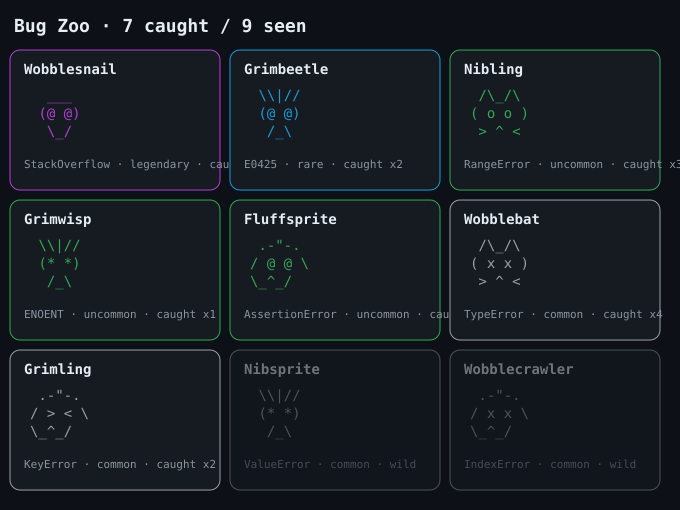
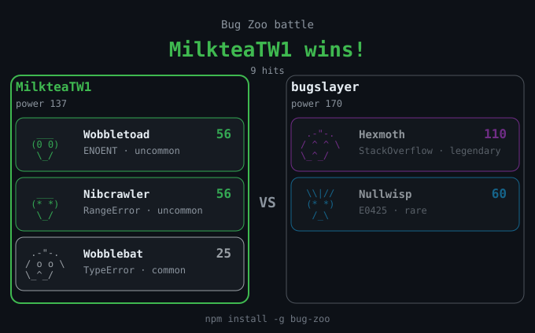
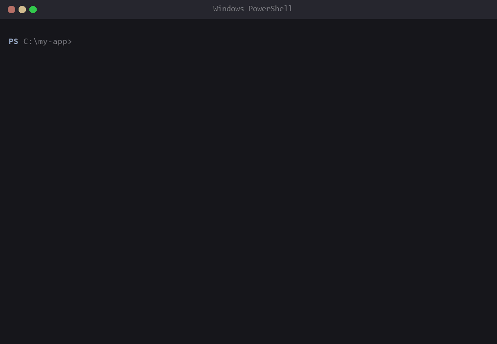
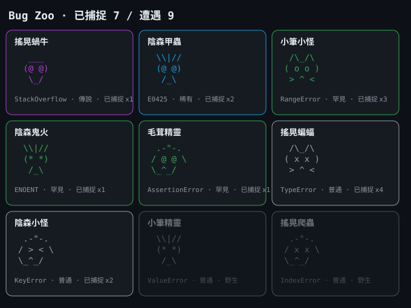
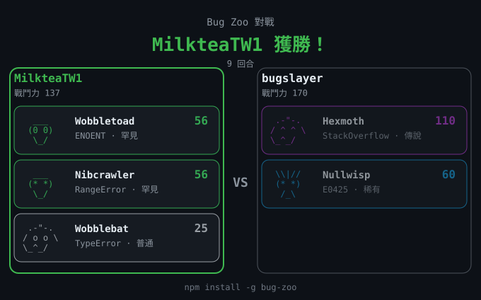

# Bug Zoo

Turn your error messages into collectible monsters.

[](https://github.com/MilkteaTW1/bug-zoo/actions/workflows/test.yml) [](https://www.npmjs.com/package/bug-zoo) [](LICENSE)

**Catch bugs, build a team, battle your friends.**

- **Fix to catch**: a crash spawns a monster; fix the code and re-run the command to catch it.
- **Power from your real project**: stack depth, blast radius, size and failure rate decide how strong it is.
- **Battle friends, no server**: climb a ladder or fight a friend's code; no accounts, no database.

*For developers who stare at stack traces all day (their own, or their AI assistant's) and would like it to feel a bit more like a game.*

**English** | [繁體中文](#zh-TW)


*A bug appears, you fix it, it is caught, your team fights. Real output; Node-internal stack frames trimmed.*

## Install

```bash
npm install -g bug-zoo
bugzoo setup
```

Requires Node.js 18+. No dependencies. `bugzoo setup` asks for your language (繁體中文 / 简体中文 / English) and a player name for the leaderboards. It changes nothing on your machine except Bug Zoo's own data file.

## Play in 30 seconds

```bash
bugzoo run node app.js    # 1. your program crashes: a bug appears
# 2. fix the bug in your code
bugzoo run node app.js    # 3. same command, clean run: caught!
```

Works with any command (`bugzoo run python main.py`, `bugzoo run npm test`, ...). No project to try it on? `playground/` has three broken programs; see [playground/GUIDE.md](playground/GUIDE.md).

## VS Code extension

Prefer to watch your bugs roam around the editor? The [VS Code extension](vscode/) turns failing terminal commands into monsters in the side bar, with the ladder, friends and animated fights built in. It shares the same data file as the CLI.

**Install:** search for **Bug Zoo** in the VS Code Extensions view, or [get it from the Marketplace](https://marketplace.visualstudio.com/items?itemName=MilkteaTW1.bug-zoo-vscode).

[](https://github.com/MilkteaTW1/bug-zoo/blob/main/vscode/docs/bug-zoo-promo.en.mp4)

*Click to watch the 36-second promo video.*

**A crash spawns a monster. Fix it, and it is caught.**


**Climb the ladder with a turn-by-turn battle replay.**


**Add friends, fight them any time, share your team with a code.**


## Commands

| Command | What it does |
|---|---|
| `bugzoo run <command…>` | Run a command; if it fails a bug appears; fix it and re-run to catch it |
| `bugzoo dex` | Your collection and the bugs waiting to be caught |
| `bugzoo team` | Your strongest catches: power breakdown, form and the next evolution |
| `bugzoo achievements` | Your 13 achievements |
| `bugzoo battle` | Shows the ladder, your friends and a practice opponent; type a number to fight. `--card f.svg` saves a shareable result card |
| `bugzoo battle <code\|url\|file\|name>` | Fight one friend code, link, file or ladder player directly |
| `bugzoo friend` | List friends. Also `code`, `add <code\|url\|file\|name>`, `remove <name>`, `refresh` |
| `bugzoo ladder` | Show the ladder |
| `bugzoo rank` | Your score and title |
| `bugzoo lang [code]` | Show the languages, or switch in one line: `bugzoo lang zh-CN` (changes nothing else) |
| `bugzoo setup` | Language, player name, optional automatic capture and the AI-assistant hook (`--lang`, `--name`, `--auto on\|off`, `--ai on\|off`) |
| `bugzoo share` | Write a shareable score + team file (counts only, no error text) |
| `bugzoo leaderboard <dir>` | Build a score leaderboard from shared files |
| `bugzoo scan` | Scan this project: size and most-depended-on modules |
| `bugzoo hook <shell>` | Print a wrapper snippet for bash, zsh, fish or PowerShell |
| `bugzoo export` | Export the bestiary as an SVG for your profile |

## Share your zoo

Everything you earn can be pasted somewhere:

```bash
bugzoo export zoo.svg    # a card grid of your bestiary, ready for a profile README
bugzoo battle --card r.svg   # a result card for the fight you just had
bugzoo friend code       # your team as one pasteable code
bugzoo rank              # your score and title
```



*A sample `bugzoo export`: rarity colours the border, uncaught monsters are faded.*



*A sample `bugzoo battle --card`. Fights are deterministic, so the same two teams always give the same card.*

## Catching a bug

A failing run only *spawns* a bug. You catch it by fixing the code and re-running the same command in the same folder:

| Re-run result | Outcome |
|---|---|
| Clean run | Caught |
| Same bug | Still there |
| Some bugs gone, nothing new | Those are caught, the rest stay wild |
| A different or additional bug | Escaped - the new bug becomes your target |

"Same command" ignores flags and numeric arguments, so `node app.js` and `node ./app.js --debug --port 3000` are the same target.

## Automatic capture (optional)

If you would rather not type `bugzoo run`, turn this on:

```bash
bugzoo setup --auto on
```

It is **off unless you ask for it**, because it changes your environment: a `NODE_OPTIONS` user environment variable and small blocks in your terminal profiles. `bugzoo setup` lists exactly what it will change and asks first. Undo everything any time with `bugzoo setup --auto off`.

With it on, whatever you run **by hand** in a terminal is captured, in any project, in any folder:

| Layer | Covers | How |
|---|---|---|
| Node preload | any `node` program started from a terminal | `NODE_OPTIONS` loads `src/register.js`, which records the run on exit |
| Command wrappers | `python`, `py`, `pytest`, `go`, `cargo`, `java`, `mvn`, `gradle`, `dotnet`, `ruby`, `php`, `deno`, `bun`, `make`, `npm`, `npx`, `pnpm`, `yarn` | cmd `doskey` macros via `AutoRun`, a PowerShell profile block, or a bash/zsh profile block |

- **Only actively started runs count.** The Node preload requires a terminal (TTY); wrappers only apply to lines you type. Editors, bundlers and background tools are ignored, and `node_modules` and npm itself are never tracked.
- A healthy program with no pending bug writes nothing and prints nothing.
- Open a new terminal after turning it on. Pause it with `BUGZOO_DISABLE=1`.
- **Limits**: a language not in the list above needs `bugzoo run <command>`. Runs started by an IDE's Run button (no terminal) are not captured. Wrapped commands have their stderr and stdout piped through bugzoo, so a few tools may drop colours.
- **Commands that ask questions** (`npm publish`, `npm login`, `npm init`, `npx`, ...) are passed straight through untouched and not recorded, because capturing their output would stop them prompting. `BUGZOO_DISABLE=1` does the same for any command, which is also the fix for programs with a full-screen terminal UI.
- **What is tested**: the whole test suite runs in CI on Windows, macOS and Linux (Node 18, 20, 22), and the bash wrappers run in a real bash there. The cmd and PowerShell wrappers were checked by hand on Windows; zsh and fish are covered as generated text only.
- Windows PowerShell ignores profiles when its execution policy is `Restricted`; `bugzoo setup` tells you if so.

## When your AI assistant runs the code (Claude Code)

An AI assistant runs commands without a terminal, so automatic capture stays quiet for them. A hook fills that gap:

```bash
bugzoo setup --ai on     # adds Bash hooks to ~/.claude/settings.json; --ai off removes them
```

Restart Claude Code, then work as usual:

1. The assistant runs your code and it fails: **a monster appears** in your conversation.
2. The assistant fixes it and re-runs the same command: **caught**, with power, evolution and achievements like any other run.

- The card is shown **to you only**. It is sent as the hook's `systemMessage`, never as context for the model, so it costs no tokens and cannot confuse the assistant.
- Same identity as by hand: `node app.js` run by the assistant and by you is the same target, so it can fail in one place and be caught in the other. `cd proj && node app.js 2>&1 | tail` counts as `node app.js`.
- Limits: Claude Code only, and only its Bash tool. A command that also changes files (`printf ... > f.js && node f.js`) is a different command from `node f.js`, so it will not match a later clean run. Checked on Windows with Claude Code desktop; the hook format follows Claude Code's documentation.
- Bug Zoo only edits the hooks it added, refuses to touch a settings file that is not plain JSON, and `--ai off` removes exactly those entries.

**Other assistants** (checked against their documentation on 2026-10-14, not tried live):

| Assistant | Post-command hook | Why it is not supported yet |
|---|---|---|
| Cursor | `afterShellExecution` | The event carries the command and its output but **no exit code**, and there is no documented way to show a message only to the person, so a monster would have nowhere to appear. |
| Gemini CLI | `AfterTool` (shell tool) | It has a `systemMessage` shown to the user, but the shell tool's `tool_response` fields (exit code, `llmContent`, `returnDisplay`) are not documented well enough to detect a failure reliably. |

If you use one of these, [open an issue](https://github.com/MilkteaTW1/bug-zoo/issues) with a sample hook payload and it can be added.

## Power and fair play

Every bug has a power, snapshotted while it is alive and banked as a trophy when you catch it. Catching the same `TypeError` in two projects gives two trophies with different power.

`power = base(rarity) x (1 + depth + blast + size + rate)`

| Factor | Measured by | Max |
|---|---|---|
| depth | project files in the stack trace | +1.0 |
| blast | project files that import the failing file (the whole project is scanned) | +1.0 |
| size | total lines of code in the project (log scale) | +0.5 |
| rate | failures / max(runs, 5) of that command; a bug you keep hitting grows | +1.0 |

Base: common 10, uncommon 25, rare 60, legendary 150. Your top 3 trophies form your team.

**This is a game, not a skill test.** Power rewards bugs that keep failing, so it can be gamed by breaking things on purpose. Failures of one command count at most once a minute, which only slows that down. Scores and teams are self-reported: the ladder replays fights from the teams you submit but cannot verify how you earned them. Treat rankings as fun between friends, not as proof of how well you debug.

## Evolution and achievements

Meeting the same bug again and again is not wasted: its form changes.

| Catches of the same bug | Form | Power |
|---|---|---|
| 1-2 | base | x1.00 |
| 3 | Evolved `*` | x1.15 |
| 10 | Ascended `**` | x1.35 |

The bonus is applied when a team is formed (`battle`, `friend code`, `share`); a trophy's recorded power never changes. `bugzoo team` shows each monster's form and how many catches are left until the next one.

`bugzoo achievements` lists 13 achievements, from your first catch to a 7-day streak, a legendary, or your first win. They are unlocked as you play and announced right after the run that earned them.

## Battles and the ladder

```bash
bugzoo battle
```

lists the **ladder**, your **friends** and a **practice** opponent; type a number to fight.

```
Ladder
 1. #1   bugslayer          power  160  <counts for ranking>
 2. #2   dev-dana           power  110  <counts for ranking>
 3. #3   rookie             power   10  <counts for ranking>
  . #4   you                power   16  <you>

Friends
 4.      xiaoming           power   25  <code>

Practice
 5.      Legacy Codebase    power  195
Fight whom? (number, or q to quit)
```

- Teams fight one at a time; the survivor keeps its remaining HP. The fight is seeded from both teams, so both players get the same result and nobody can re-roll luck.
- **The ladder is read straight from this GitHub repo** (`leaderboard/`). No clone, no server of ours. If GitHub is unreachable the last saved copy is used.
- **New here? Your first ladder fight puts you on the ladder, win or lose.** You start at the bottom, then climb.
- **Beat someone up to 3 ranks above you to take their spot.** The CLI prints a pre-filled GitHub issue link; press *Submit new issue* and a workflow replays the fight from your shared team, then updates the ladder within a minute or two.
- Fighting friends and the practice opponent is friendly: it never changes the ladder.
- A player name belongs to the first GitHub account that submits with it, so nobody can submit as someone else.

## Friends

No accounts and no server: a friend is a team you can reach.

```bash
bugzoo friend code                 # your friend code: send it in any chat
bugzoo friend add BZ1.xxxxxxxx     # add a friend from their code
bugzoo friend add alice            # add anyone on the ladder; their team stays current
bugzoo friend add https://…/bob.json   # a link to a shared score file, refreshed each time
bugzoo friend add ./carol.json     # a local file
bugzoo friend remove alice
```

A code is a snapshot of a team (name and up to 3 monsters). Ladder names, links and files are refreshed when you open `bugzoo battle`. Power in anything you import is clamped to what each rarity can reach.

## Score leaderboard (no database)

Scores are first catches by rarity (common 10, uncommon 25, rare 60, legendary 200) plus 2 per repeat catch.

```bash
bugzoo share --name alice --out leaderboard/scores/alice.json
```

The file contains only counts and your team: no error messages, paths or commands. A GitHub Action runs `bugzoo leaderboard leaderboard/scores --out LEADERBOARD.md` and commits the table.

Running your own ladder? Fork the repo and set `BUGZOO_LADDER_REPO=owner/repo` (or `BUGZOO_LADDER_DIR` for a local folder).

## How it works

- **Parsing**: recognises the error formats of Node, Python, pytest, Java, .NET, Go, Rust, TypeScript, gcc/clang, Gradle and npm, falling back to error codes (`ENOENT`, `SIGSEGV`) and signals. stdout is the backup source for tools that report failures there.
- **Identity**: the monster is derived from a hash of the error type plus the message with numbers, quoted names and paths stripped, so `Cannot read 'a'` and `Cannot read 'b'` are the same creature.
- **Rarity**: common (`TypeError`, `KeyError`...), uncommon (`ENOENT`, `RangeError`...), rare (anything else), legendary (`SIGSEGV`, `ENOSPC`, `StackOverflow`...).
- **Storage**: `~/.bugzoo/dex.json` (override with `BUGZOO_HOME`). Nothing leaves your machine unless you share or submit it.
- **Demo GIFs** are rendered from real output by `python tools/make-gif.py` (needs Pillow and Windows fonts). `node demo/demo.js` plays a similar session live.

## Roadmap

- Evolution when you meet the same monster many times
- More languages' error formats

## Add your language

Each language is one file in [`src/locales/`](src/locales). To add yours:

```bash
npm run lang -- ja 日本語     # creates src/locales/ja.js from the English text
# translate "help" and "messages" in that file
npm run lang:check            # shows what is still English
npm test
```

Nothing else needs editing: the language shows up in `bugzoo setup`, is picked from the system locale automatically, and also translates the [VS Code extension](vscode/) (its texts are the `vs.*` keys in the same file). Optionally add `vscode/package.nls.<locale>.json` for the extension's command names. See [CONTRIBUTING.md](CONTRIBUTING.md).

## License

MIT

---

<a id="zh-TW"></a>

# Bug Zoo（繁體中文）

把你的錯誤訊息變成可收集的怪物。

[](https://github.com/MilkteaTW1/bug-zoo/actions/workflows/test.yml) [](https://www.npmjs.com/package/bug-zoo) [](LICENSE)

**抓 bug、組隊、和朋友對戰。**

- **修好才抓得到**：程式一壞就出現怪物，修好程式、重跑同一條指令就能捕捉。
- **戰鬥力來自你的真實專案**：堆疊深度、影響範圍、專案規模與失敗頻率，決定牠有多強。
- **和朋友對戰，不需要伺服器**：爬天梯，或直接挑戰朋友的代碼；沒有帳號、沒有資料庫。

*給每天盯著錯誤堆疊的開發者（不管是自己寫的，還是 AI 寫的），讓它多一點遊戲的感覺。*

[English](#bug-zoo) | **繁體中文**



*bug 出現、你修好它、捕捉成功、隊伍對戰。內容是真實輸出，僅省略了 Node 內部的堆疊行。*

## 安裝

```bash
npm install -g bug-zoo
bugzoo setup
```

需要 Node.js 18 以上，沒有任何相依套件。`bugzoo setup` 會詢問語言（繁體中文／English）和排行榜用的玩家名稱，除了 Bug Zoo 自己的資料檔，不會改動你電腦上的任何東西。

## 30 秒玩一次

```bash
bugzoo run node app.js    # 1. 你的程式壞了：出現一隻 bug
# 2. 去把程式裡的 bug 修好
bugzoo run node app.js    # 3. 同一條指令，乾淨通過：捕捉成功！
```

任何指令都行（`bugzoo run python main.py`、`bugzoo run npm test`…）。沒有專案可以試？`playground/` 裡有三支故意壞掉的程式，說明見 [playground/GUIDE.md](playground/GUIDE.md)。

## VS Code 擴充套件

想看 bug 在編輯器裡跑來跑去？[VS Code 擴充套件](vscode/)會把終端機裡失敗的指令變成側邊欄的怪物，內建天梯、好友和動畫對戰，和 CLI 共用同一份資料檔。

**安裝:**在 VS Code 擴充套件面板搜尋 **Bug Zoo**,或[到 Marketplace 安裝](https://marketplace.visualstudio.com/items?itemName=MilkteaTW1.bug-zoo-vscode)。

[](https://github.com/MilkteaTW1/bug-zoo/blob/main/vscode/docs/bug-zoo-promo.zh.mp4)

*點圖觀看 36 秒宣傳影片。*

**當機就生出怪物，修好它就能捕獲。**


**爬天梯，還有逐回合的戰鬥重播。**


**加好友、隨時開戰、用代碼分享你的隊伍。**


## 指令表

| 指令 | 功能 |
|---|---|
| `bugzoo run <指令…>` | 執行指令，失敗時出現 bug；修好後重跑就能捕捉 |
| `bugzoo dex` | 你的圖鑑與等著被捕捉的 bug |
| `bugzoo team` | 你最強的捕獲：戰鬥力明細、型態與下一次進化 |
| `bugzoo achievements` | 你的 13 個成就 |
| `bugzoo battle` | 列出天梯、好友與練習對手，輸入編號就開打；`--card f.svg` 會存成可分享的戰鬥結果卡 |
| `bugzoo battle <代碼\|網址\|檔案\|名稱>` | 直接和某個好友代碼、連結、檔案或天梯玩家對戰 |
| `bugzoo friend` | 列出好友。也可用 `code`、`add <代碼\|網址\|檔案\|名稱>`、`remove <名稱>`、`refresh` |
| `bugzoo ladder` | 查看天梯 |
| `bugzoo rank` | 你的分數與稱號 |
| `bugzoo lang [代碼]` | 查看語言清單，或一行切換：`bugzoo lang zh-CN`（不會動到其他設定） |
| `bugzoo setup` | 語言、玩家名稱、選用的自動捕捉與 AI 助手 hook（`--lang`、`--name`、`--auto on\|off`、`--ai on\|off`） |
| `bugzoo share` | 輸出可分享的分數與隊伍檔（只有數量，不含錯誤內容） |
| `bugzoo leaderboard <資料夾>` | 用分享檔產生分數排行榜 |
| `bugzoo scan` | 掃描這個專案：規模與最多檔案依賴的模組 |
| `bugzoo hook <shell>` | 輸出 bash、zsh、fish、PowerShell 的包裝設定片段 |
| `bugzoo export` | 把圖鑑匯出成 SVG，放到你的個人頁 |

## 分享你的動物園

你賺到的一切，都可以貼到別的地方：

```bash
bugzoo export zoo.svg    # 圖鑑的卡片圖，可直接放進個人頁 README
bugzoo battle --card r.svg   # 剛打完那場的戰鬥結果卡
bugzoo friend code       # 把你的隊伍變成一段可貼上的代碼
bugzoo rank              # 你的分數與稱號
```



*`bugzoo export` 的範例：稀有度決定邊框顏色，還沒捕捉到的怪物會變淡。*



*`bugzoo battle --card` 的範例。戰鬥是固定的，所以同樣兩支隊伍永遠產生同一張卡。*

## 捕捉規則

失敗的執行只會讓 bug **出現**。你要修好程式，再於同一個資料夾執行同一條指令，才算捕捉：

| 重跑結果 | 判定 |
|---|---|
| 乾淨通過 | 捕捉成功 |
| 還是同一個 bug | 牠還在 |
| 部分 bug 消失，沒有新的 | 消失的那些捕捉成功，其餘仍在 |
| 出現不同或更多的 bug | 逃走了，新的 bug 變成目標 |

「同一條指令」會忽略旗標與純數字參數，所以 `node app.js` 和 `node ./app.js --debug --port 3000` 視為相同。

## 自動捕捉（選用）

不想每次都打 `bugzoo run` 的話，可以開啟：

```bash
bugzoo setup --auto on
```

**預設是關的，要你主動開才會啟用**，因為它會改動你的環境：使用者環境變數 `NODE_OPTIONS`，以及終端機設定檔裡的小區塊。`bugzoo setup` 會先列出會改什麼並詢問你。想全部還原隨時可以用 `bugzoo setup --auto off`。

開啟後，你在終端機**手動執行**的程式，不管哪個專案、哪個資料夾都會被捕捉：

| 機制 | 涵蓋 | 做法 |
|---|---|---|
| Node 預載 | 從終端機啟動的任何 `node` 程式 | `NODE_OPTIONS` 載入 `src/register.js`，程式結束時記錄 |
| 指令包裝 | `python`、`py`、`pytest`、`go`、`cargo`、`java`、`mvn`、`gradle`、`dotnet`、`ruby`、`php`、`deno`、`bun`、`make`、`npm`、`npx`、`pnpm`、`yarn` | cmd 的 `doskey`（透過 `AutoRun`）、PowerShell 設定檔區塊、bash/zsh 設定檔區塊 |

- **只算主動執行的**：Node 預載需要有終端機（TTY），指令包裝只對你打的那一行生效。編輯器、打包工具等背景程式不會被算進去，`node_modules` 與 npm 本身也不會被追蹤。
- 正常通過且沒有未解決 bug 的程式，不會寫入、也不會輸出任何東西。
- 開啟後需要**重新開啟終端機**才會生效。暫時停用：`BUGZOO_DISABLE=1`。
- **限制**：上表以外的語言要用 `bugzoo run <指令>`；從 IDE 的執行按鈕啟動（沒有終端機）不會被捕捉；被包裝的指令，其 stderr 與 stdout 會經過 bugzoo，少數工具可能會失去顏色。
- **會問問題的指令**（`npm publish`、`npm login`、`npm init`、`npx` 等）會原封不動直通、也不記錄，因為擷取輸出會讓它們不再詢問。`BUGZOO_DISABLE=1` 可對任何指令達到同樣效果，遇到有全螢幕終端介面的程式也用這個。
- **測試範圍**：完整測試在 CI 上於 Windows、macOS、Linux（Node 18、20、22）執行，bash 包裝也在那裡的真實 bash 中執行。cmd 與 PowerShell 的包裝是在 Windows 上人工驗證；zsh 與 fish 只有產生出來的文字有測試。
- Windows PowerShell 的執行原則是 `Restricted` 時會忽略設定檔，`bugzoo setup` 會提醒你。

## 當 AI 助手幫你跑程式（Claude Code）

AI 助手執行指令時沒有終端機，所以自動捕捉對它們不會有反應。這個 hook 補上這個缺口：

```bash
bugzoo setup --ai on     # 把 Bash hook 加進 ~/.claude/settings.json；--ai off 會移除
```

重新啟動 Claude Code，然後照平常的方式工作：

1. AI 助手跑你的程式、失敗了：對話裡會**出現一隻怪物**。
2. AI 助手修好、重跑同一條指令：**捕捉成功**，戰鬥力、進化與成就都和其他執行一樣。

- 卡片**只給你看**：它是以 hook 的 `systemMessage` 送出，不會成為模型的上下文，所以不花 token，也不會讓助手困惑。
- 和手動執行是同一個身分：助手與你各自執行的 `node app.js` 是同一個目標，可以在一邊失敗、在另一邊捕捉。`cd proj && node app.js 2>&1 | tail` 會當成 `node app.js`。
- 限制：只支援 Claude Code 的 Bash 工具。同時會改檔案的指令（`printf ... > f.js && node f.js`）和單獨的 `node f.js` 是不同的指令，所以不會和之後的乾淨執行配對。已在 Windows 的 Claude Code 桌面版驗證；hook 格式依 Claude Code 官方文件。
- Bug Zoo 只會動它自己加的 hook；設定檔不是純 JSON 時絕不覆寫；`--ai off` 只會移除它自己加的項目。

**其他 AI 助手**（依官方文件於 2026-10-14 查證，沒有實際操作過）：

| 助手 | 指令後的 hook | 為什麼還沒支援 |
|---|---|---|
| Cursor | `afterShellExecution` | 事件有指令與輸出，但**沒有結束碼**，也沒有文件記載的「只給使用者看」的訊息管道，怪物沒有地方可以出現。 |
| Gemini CLI | `AfterTool`（shell 工具） | 有顯示給使用者的 `systemMessage`，但 shell 工具的 `tool_response` 欄位（結束碼、`llmContent`、`returnDisplay`）文件寫得不夠清楚，無法可靠判斷失敗。 |

如果你用的是其中一個，歡迎[開 issue](https://github.com/MilkteaTW1/bug-zoo/issues) 並附上 hook 收到的範例資料，就能補上。

## 戰鬥力與公平性

每隻 bug 都有戰鬥力，在牠還活著時記錄下來，捕捉成功時變成戰利品。同一種 `TypeError` 在兩個專案裡抓到，戰鬥力會不一樣。

`戰鬥力 = 稀有度基礎值 × (1 + 堆疊深度 + 影響範圍 + 專案規模 + 錯誤率)`

| 因子 | 怎麼量 | 上限 |
|---|---|---|
| 堆疊深度 | 錯誤堆疊裡有幾個專案內的檔案 | +1.0 |
| 影響範圍 | 出錯的檔案被專案內多少檔案引用（會掃描整個專案） | +1.0 |
| 專案規模 | 專案總行數（取對數） | +0.5 |
| 錯誤率 | 這條指令的失敗次數 ÷ max(執行次數, 5)，一直踩同一個 bug 會越來越強 | +1.0 |

基礎值：普通 10、罕見 25、稀有 60、傳說 150。前三強戰利品組成你的隊伍。

**這是遊戲，不是能力測驗。** 戰鬥力獎勵「一直失敗的 bug」，所以可以靠故意弄壞程式來灌水。同一條指令的失敗每分鐘最多只算一次，這只能讓灌水變慢。分數與隊伍都是自行回報：天梯會用你送出的隊伍重播戰鬥，但無法驗證你是怎麼得到的。排名請當作朋友之間的樂趣，不要當成除錯能力的證明。

## 進化與成就

一直遇到同一個 bug 並不是白費：牠的型態會改變。

| 同一隻 bug 的捕捉次數 | 型態 | 戰鬥力 |
|---|---|---|
| 1–2 次 | 一般 | ×1.00 |
| 3 次 | 第二型態 `*` | ×1.15 |
| 10 次 | 覺醒型態 `**` | ×1.35 |

加成在組隊時才套用（`battle`、`friend code`、`share`），戰利品當初記錄的戰鬥力不會改變。`bugzoo team` 會顯示每隻怪物的型態，以及距離下一次進化還差幾次。

`bugzoo achievements` 列出 13 個成就，從第一隻捕捉、連續 7 天、傳說級，到第一場勝利。成就在你玩的過程中解鎖，並在達成的那次執行後立刻通知你。

## 對戰與天梯

```bash
bugzoo battle
```

會列出**天梯**、你的**好友**和**練習**對手，輸入編號就開打。

```
天梯
 1. #1   bugslayer          戰鬥力  160  <計入排名>
 2. #2   dev-dana           戰鬥力  110  <計入排名>
 3. #3   rookie             戰鬥力   10  <計入排名>
  . #4   你                 戰鬥力   16  <你>

好友
 4.      小明               戰鬥力   25  <代碼>

練習
 5.      Legacy Codebase    戰鬥力  195
要跟誰對戰？（輸入編號，q 離開）
```

- 隊伍依序單挑，存活者保留剩餘血量。戰鬥用雙方隊伍當亂數種子，所以雙方算出的結果一致，也不能重複洗運氣。
- **天梯直接從這個 GitHub repo 讀取**（`leaderboard/`），不用 clone、也沒有我們自己的伺服器。連不上 GitHub 時會用上次儲存的副本。
- **新玩家第一次打天梯，不論輸贏都會加入天梯。** 從最底下開始往上爬。
- **打贏排名在你上面 3 名以內的人，就奪下他的名次。** CLI 會印出一個預先填好的 GitHub Issue 連結，按下 *Submit new issue*，工作流程會用你分享的隊伍重新播放戰鬥，一兩分鐘內更新天梯。
- 和好友、練習對手對戰只是切磋，不會影響天梯。
- 玩家名稱歸第一個用它送出的 GitHub 帳號所有，沒有人能冒用別人的名字。

## 好友

沒有帳號、沒有伺服器：好友就是一支你拿得到的隊伍。

```bash
bugzoo friend code                 # 你的好友代碼，貼到任何聊天室
bugzoo friend add BZ1.xxxxxxxx     # 用對方的代碼加好友
bugzoo friend add alice            # 加天梯上的任何人，隊伍會保持最新
bugzoo friend add https://…/bob.json   # 分享檔的連結，每次都會更新
bugzoo friend add ./carol.json     # 本機檔案
bugzoo friend remove alice
```

好友代碼是隊伍的快照（名稱加上最多 3 隻怪物）。天梯名稱、連結與檔案會在你開啟 `bugzoo battle` 時更新。匯入的內容，戰鬥力都會被限制在該稀有度能達到的上限內。

## 分數排行榜（不用資料庫）

首次捕捉依稀有度給分（普通 10、罕見 25、稀有 60、傳說 200），重複捕捉每次 +2。

```bash
bugzoo share --name alice --out leaderboard/scores/alice.json
```

分享檔只含數量與隊伍，不含錯誤訊息、路徑或指令。GitHub Action 會執行 `bugzoo leaderboard leaderboard/scores --out LEADERBOARD.md` 並提交表格。

想自己架一個天梯？Fork 這個 repo，並設定 `BUGZOO_LADDER_REPO=owner/repo`（或用 `BUGZOO_LADDER_DIR` 指向本機資料夾）。

## 運作原理

- **解析**：辨識 Node、Python、pytest、Java、.NET、Go、Rust、TypeScript、gcc/clang、Gradle 與 npm 的錯誤格式，其次是錯誤代碼（`ENOENT`、`SIGSEGV`）與訊號。把錯誤印在 stdout 的工具，會用 stdout 當備援。
- **身分**：怪物由錯誤類型加上「去掉數字、引號內名稱與路徑的訊息」的雜湊決定，所以 `Cannot read 'a'` 與 `Cannot read 'b'` 是同一隻。
- **稀有度**：普通（`TypeError`、`KeyError`…）、罕見（`ENOENT`、`RangeError`…）、稀有（其他）、傳說（`SIGSEGV`、`ENOSPC`、`StackOverflow`…）。
- **儲存位置**：`~/.bugzoo/dex.json`（可用 `BUGZOO_HOME` 覆寫）。除非你主動分享或送出，不會有任何資料離開你的電腦。
- **示範 GIF** 由 `python tools/make-gif.py` 依真實輸出渲染（需要 Pillow 與 Windows 字型）；`node demo/demo.js` 會在終端機即時播放類似的流程。

## 之後想做的

- 同一隻怪物遇見很多次後會進化
- 支援更多語言的錯誤格式

## 新增你的語言

每個語言就是 [`src/locales/`](src/locales) 裡的一個檔案。新增方式：

```bash
npm run lang -- ja 日本語     # 以英文內容建立 src/locales/ja.js
# 翻譯該檔案裡的 "help" 與 "messages"
npm run lang:check            # 檢查還有哪些是英文
npm test
```

不用改其他檔案：新語言會自動出現在 `bugzoo setup`、依系統語系自動選用，也會同時翻譯 [VS Code 擴充套件](vscode/)（它的文字就是同一個檔案裡的 `vs.*`）。可另外新增 `vscode/package.nls.<locale>.json` 翻譯擴充套件的指令名稱。詳見 [CONTRIBUTING.md](CONTRIBUTING.md)。

## 授權

MIT
