# Bug Zoo for VS Code

[](https://marketplace.visualstudio.com/items?itemName=MilkteaTW1.bug-zoo-vscode)

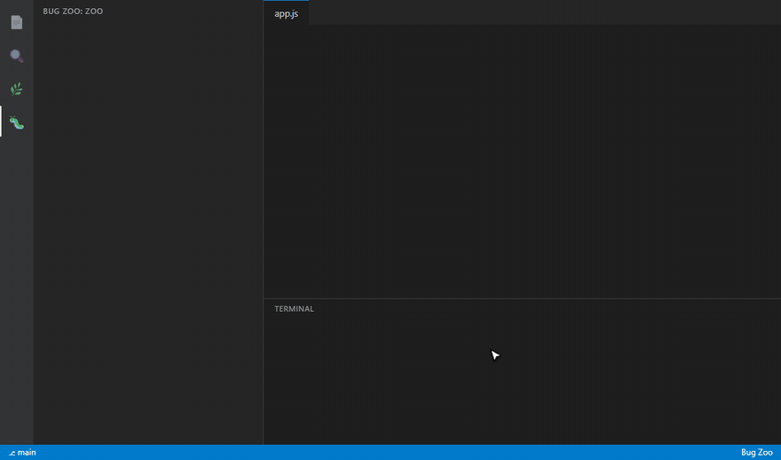

Your failing terminal commands become little monsters that wander around the side bar. Fix the bug, run the same command again, and the monster is caught and moves into your pen.

It uses the same engine as the [`bug-zoo` CLI](https://github.com/MilkteaTW1/bug-zoo), so monsters, rarity, power, evolution and achievements are identical, and both share `~/.bugzoo/dex.json`.

## See it in action

*The GIFs use demo data; the zoo, fights and replays are the real extension.*

[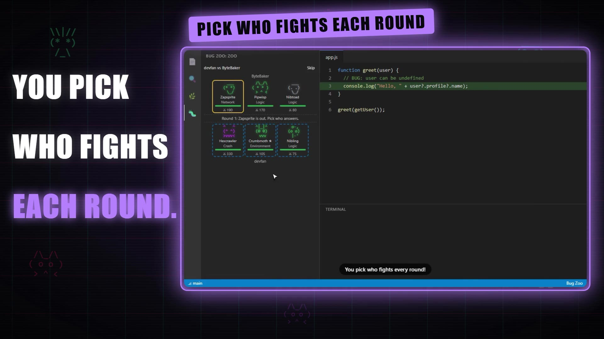](https://github.com/MilkteaTW1/bug-zoo/blob/main/vscode/docs/bug-zoo-promo.en.mp4)

*Click to watch the 44-second promo video: the catch loop, the shop, evolution and teams, then what's new in v0.6 (you pick who fights each round, one-click sharing, bulk buying), in VS Code and in the terminal. 中文版影片:[點這裡](https://github.com/MilkteaTW1/bug-zoo/blob/main/vscode/docs/bug-zoo-promo.zh.mp4)*

**Pick who fights every round.**

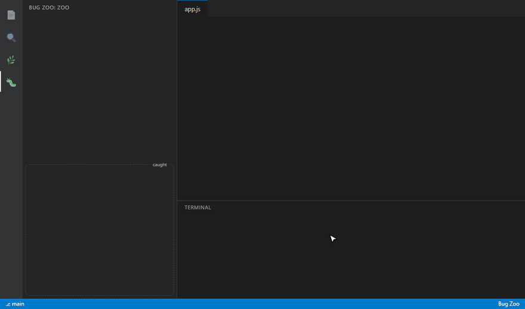

**Add friends, fight them any time, share your team with a code.**

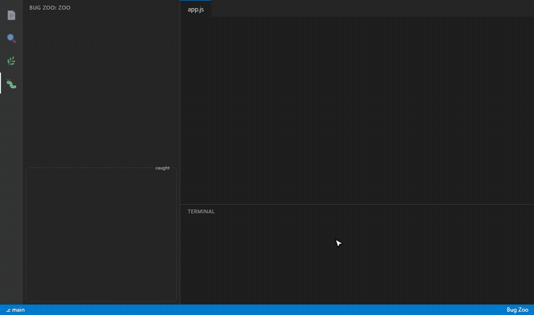

**Earn coins, shop for food and furniture, and feed your monsters until they evolve.**

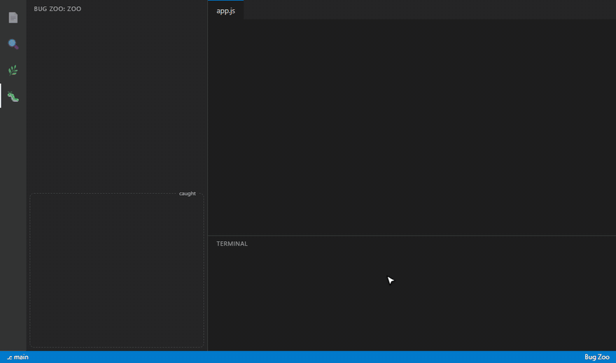

**Build a team of three, climb the Tower, and track quests and achievements.**

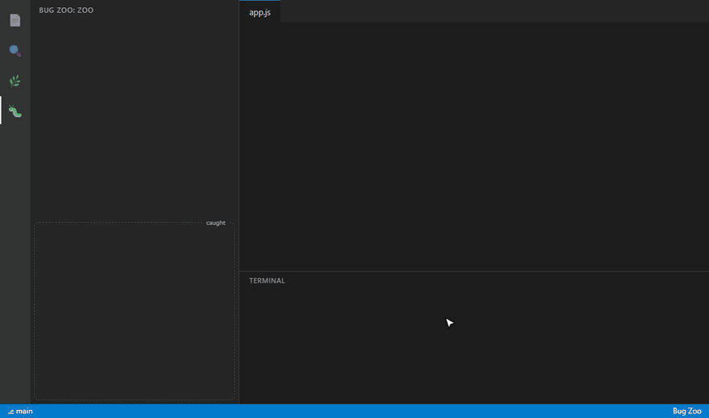

## How it works

1. Run a command in the integrated terminal (`node app.js`, `pytest`, `npm test`, ...).
2. If it fails, a wild monster drops into the Bug Zoo panel and starts running around.
3. Fix the code and run the same command again. A clean run catches it.
4. Caught monsters wander calmly in the pen, glow when they evolve, and nap now and then. Click one to pet it.

Wild bugs show their type, the date they first appeared and their battle power. Only bugs from the project folders you have open are shown.

## Fight

The bottom of the panel has a Friends tab and the other tabs below.

- **Friends**: add a friend by code (`BZ1...`), link or file, fight them any time, or fight the practice dummy Legacy Codebase. In a fight the opponent shows who it sends out and you click which of your living monsters answers each round. **Copy my code** gives you a code to send to a friend, and the 📤 button in the panel header copies a short boast about your catches, team power or Tower progress.

- **Achievements, Quests, Tower, Team**: the same tabs as the CLI. Achievements shows all of them with their unlock dates, Quests today's three goals, Tower the next floor (press **Fight**), and Team lets you click up to three monsters in the order they fight (**Auto** goes back to your strongest). Battles show each monster's element and whether a hit was super effective.
- **Zoo**: the bar shows species caught (`3/50`) and your no-error streak toward the next companion. Shiny catches and companions are marked, hovering shows the species and element, and double-click renames a monster.

- **Shop**: coins come from catches, fights and quests. Buy food and furniture, feed a monster (affection makes it evolve at 30 and 100, each form 1.5x stronger) and decorate the zoo. Caught monsters show hearts and can be dragged around with the mouse.

Fights use the same rules as `bugzoo battle`: results are deterministic and replayable, and your wins and losses count toward the same achievements.

Open the zoo from the Bug Zoo icon in the activity bar, or run **Bug Zoo: Open the zoo in an editor tab** to give it more room.

## Requirements

- VS Code 1.93 or newer with terminal shell integration (on by default for bash, zsh, fish and PowerShell).
- No `bugzoo` install needed. If you also use the CLI, they share the same data.

## Settings

| Setting | Default | What it does |
|---|---|---|
| `bugzoo.captureTerminal` | `true` | Turn failing terminal commands into monsters. Switch it off if you already ran `bugzoo setup --auto on`, or runs count twice. |
| `bugzoo.notifications` | `true` | Notify when a monster appears or is caught. |

## Privacy

Your errors and terminal output stay on your machine. The extension reads the output of terminal commands only to find error types, and stores the same small data file as the CLI. The extension makes no network request of its own, unless you add a friend by link. Your errors and data are never sent anywhere.

## Development

```bash
cd vscode
npm test            # engine and capture tests
npm run package     # vendors ../src and builds a .vsix
```

Press F5 in VS Code with this folder open to try it in an Extension Development Host.

### Languages

The zoo, the arena panel and the notifications use the same language files as the CLI: `src/locales/<code>.js` in this repo (keys starting with `vs.`). Add a language once with `npm run lang -- <code> <name>` at the repo root and it works in both. The command names in the manifest come from `package.nls.<locale>.json` (add one, e.g. `package.nls.ja.json`, copying `package.nls.json`). The language is the one saved by `bugzoo lang` or `bugzoo setup`, otherwise VS Code's display language. The globe button in the Bug Zoo view header (or the command **Bug Zoo: Change language**) switches it for the extension and the CLI at once.

## 繁體中文

語言可以隨時切換：按 Bug Zoo 面板標題列的地球按鈕（或指令「Bug Zoo：切換語言」），擴充套件與 CLI 會一起換成同一個語言；清單會自動列出專案裡現有的所有語言。

把終端機裡失敗的指令變成在側邊欄跑來跑去的怪物。修好 bug、重跑同一條指令,就能捕獲牠。內建好友對戰和逐回合的戰鬥重播,和 [`bug-zoo` CLI](https://github.com/MilkteaTW1/bug-zoo) 共用 `~/.bugzoo/dex.json`。錯誤內容只留在你的電腦,只有在你加入以連結分享的好友時才會連網。

[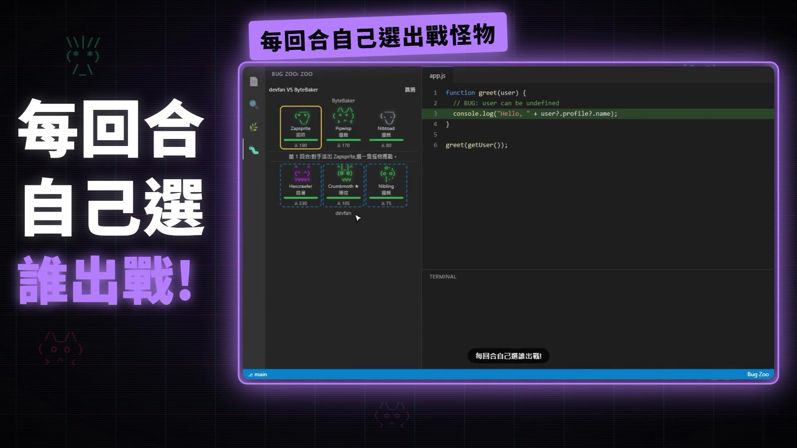](https://github.com/MilkteaTW1/bug-zoo/blob/main/vscode/docs/bug-zoo-promo.zh.mp4)

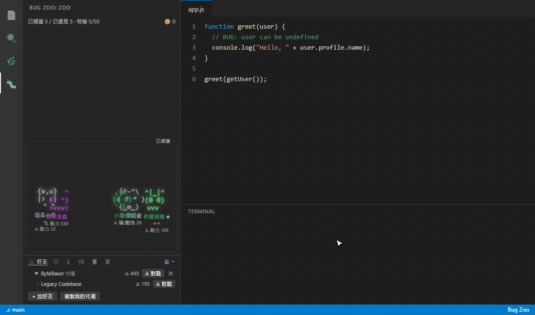

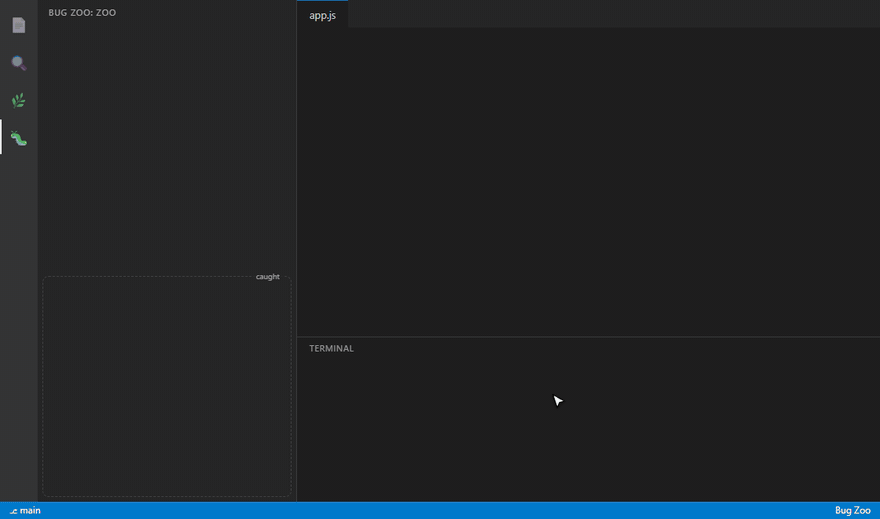

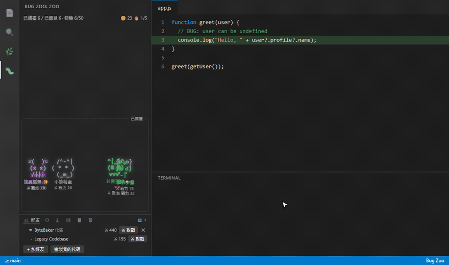

**打怪賺金幣，買食物和家具，餵到怪物進化。**

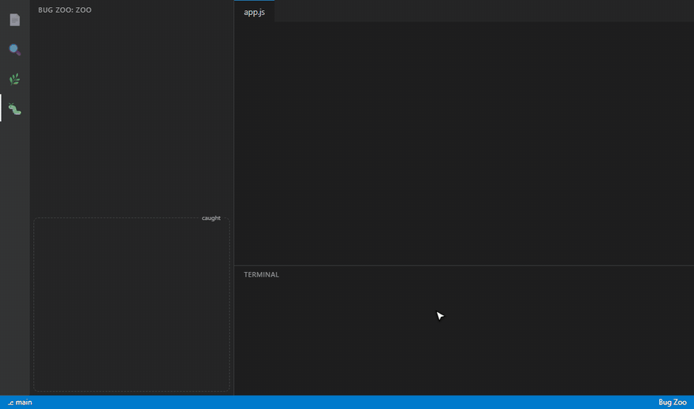

**組三隻的隊伍、爬高塔，看任務與成就。**

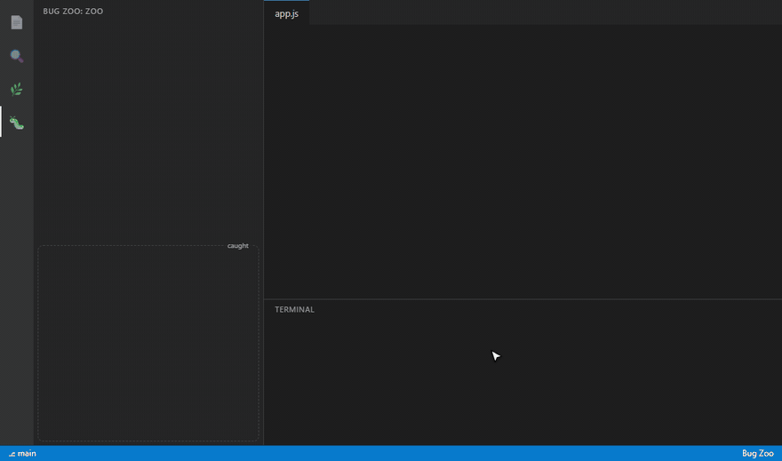
